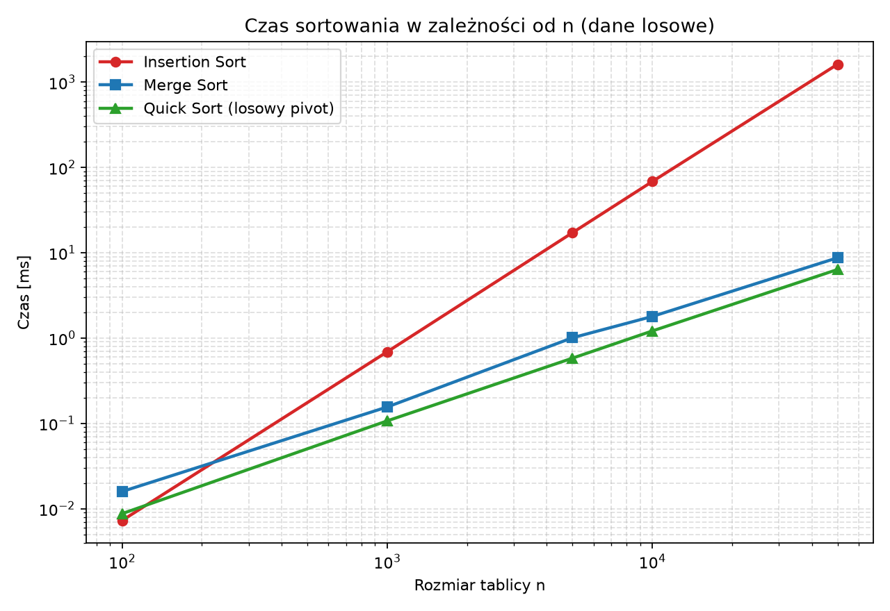
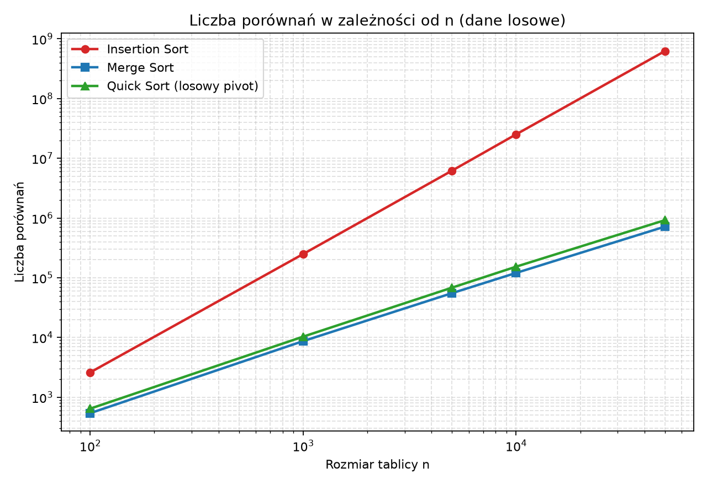
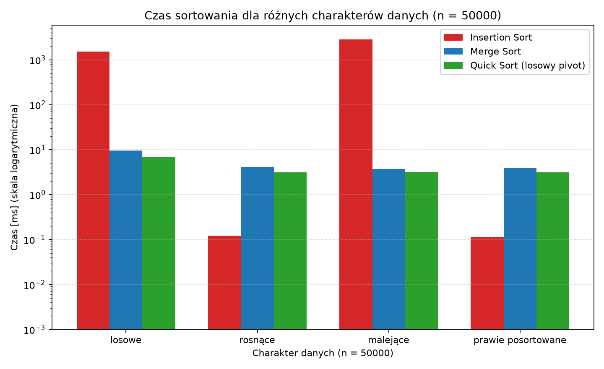
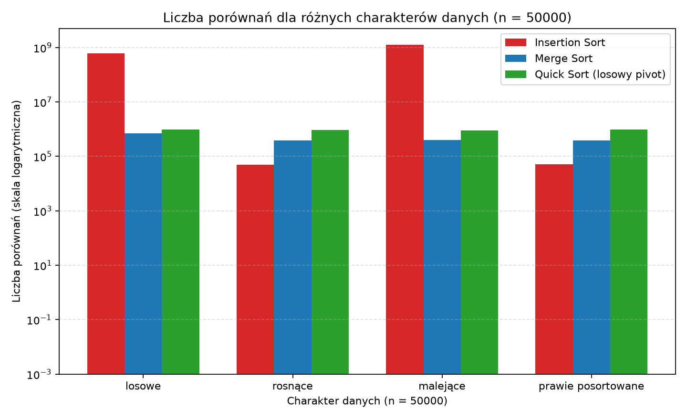

# Sprawozdanie — Laboratorium 6

**Autor:** Kacper Łapka  
**Data:** 25.11.2026

Kompilacja: `g++ -O2 -std=c++17 -DZAD1 main.cpp -o zad1` (analogicznie `-DZAD2`, `-DZAD3`, `-DZAD4`). Pomiary czasu są orientacyjne.

## Zadanie 1 — Merge Sort

Kod `main()` (`main.cpp`, `-DZAD1`):

```cpp
int main() {
  using namespace zad1;
  cout << "Demonstracja kolejnych podzialow i scalen:\n";
  testCase("8 3 6 2", {8, 3, 6, 2}, true);

  testCase("dane losowe: 7 2 9 4 1 8 3", {7, 2, 9, 4, 1, 8, 3});
  testCase("dane rosnace: 1 2 3 4 5 6 7", {1, 2, 3, 4, 5, 6, 7});
  testCase("dane malejace: 7 6 5 4 3 2 1", {7, 6, 5, 4, 3, 2, 1});
  testCase("powtarzajace sie wartosci: 5 2 8 2 1 5 8", {5, 2, 8, 2, 1, 5, 8});
  testCase("jeden element: 42", {42});
  testCase("pusta tablica", {});

  return 0;
}
```

Wynik:

```text
Demonstracja kolejnych podzialow i scalen:

== 8 3 6 2 ==
przed: 8 3 6 2 
  podzial [0,4) -> [0,2) i [2,4)
  podzial [0,2) -> [0,1) i [1,2)
  scalanie [0,1) + [1,2): 8 | 3 
  -> 3 8 
  podzial [2,4) -> [2,3) i [3,4)
  scalanie [2,3) + [3,4): 6 | 2 
  -> 2 6 
  scalanie [0,2) + [2,4): 3 8 | 2 6 
  -> 2 3 6 8 
po:    2 3 6 8 

== dane losowe: 7 2 9 4 1 8 3 ==
przed: 7 2 9 4 1 8 3 
po:    1 2 3 4 7 8 9 

== dane rosnace: 1 2 3 4 5 6 7 ==
przed: 1 2 3 4 5 6 7 
po:    1 2 3 4 5 6 7 

== dane malejace: 7 6 5 4 3 2 1 ==
przed: 7 6 5 4 3 2 1 
po:    1 2 3 4 5 6 7 

== powtarzajace sie wartosci: 5 2 8 2 1 5 8 ==
przed: 5 2 8 2 1 5 8 
po:    1 2 2 5 5 8 8 

== jeden element: 42 ==
przed: 42 
po:    42 

== pusta tablica ==
przed: (pusta)
po:    (pusta)
```

Odpowiedzi:

1. Fragment o długości co najwyżej jednego elementu (`right - left <= 1`) jest już posortowany, więc rekurencja kończy działanie.
2. Drzewo rekurencji ma około `log2(n) + 1` poziomów, czyli O(log n).
3. Pojedynczy poziom scalania ma złożoność O(n), ponieważ wszystkie elementy danego poziomu są przeglądane i kopiowane co najwyżej raz.
4. O(n) pracy na każdym z O(log n) poziomów daje O(n log n).
5. Implementacja zużywa O(n) dodatkowej pamięci na tymczasowe wektory `leftPart` i `rightPart` (plus O(log n) stosu rekurencji).
6. Wstępne uporządkowanie nie zmienia asymptotycznej klasy Merge Sort — pozostaje O(n log n), zmienia się jedynie liczba porównań i kopiowań.

## Zadanie 2 — Quick Sort

Kod `main()` (`main.cpp`, `-DZAD2`):

```cpp
int main() {
  using namespace zad2;
  cout << "=== Czesc A: pivot = ostatni element ===\n";
  testCase("dane losowe: 7 2 9 4 1 8 3", {7, 2, 9, 4, 1, 8, 3});
  testCase("dane rosnace: 1 2 3 4 5 6 7", {1, 2, 3, 4, 5, 6, 7});
  testCase("dane malejace: 7 6 5 4 3 2 1", {7, 6, 5, 4, 3, 2, 1});
  testCase("powtarzajace sie: 5 2 8 2 1 5 8", {5, 2, 8, 2, 1, 5, 8});
  testCase("jeden element: 42", {42});
  testCase("pusta tablica", {});

  cout << "\n=== Czesc B: porownanie strategii wyboru pivota ===\n";
  cout << left << setw(12) << "Dane" << right << setw(7) << "n" << setw(10)
       << "Pivot" << setw(14) << "Porownania" << setw(11) << "Zamiany"
       << setw(18) << "Maks. glebokosc" << "\n";
  cout << string(72, '-') << "\n";

  vector<int> sizes = {100, 1000, 5000, 10000};
  vector<string> dataTypes = {"losowe", "rosnace", "malejace"};
  bool allSorted = true;

  for (const auto &type : dataTypes) {
    for (int n : sizes) {
      vector<int> original = generateData(type, n);

      for (bool randomPivot : {false, true}) {
        vector<int> data = original;
        QuickStats stats;
        quickSort(data, 0, (int)data.size(), randomPivot, stats);

        if (!is_sorted(data.begin(), data.end())) {
          allSorted = false;
        }

        cout << left << setw(12) << type << right << setw(7) << n << setw(10)
             << (randomPivot ? "losowy" : "ostatni") << setw(14)
             << stats.comparisons << setw(11) << stats.swaps << setw(18)
             << stats.maxDepth << "\n";
      }
    }
  }

  cout << "\nWeryfikacja: "
       << (allSorted ? "wszystkie tablice posortowane poprawnie."
                     : "BLAD - znaleziono nieposortowana tablice.")
       << "\n";

  return 0;
}
```

Wynik:

```text
=== Czesc A: pivot = ostatni element ===
dane losowe: 7 2 9 4 1 8 3                    -> 1 2 3 4 7 8 9  (porownania: 13, zamiany: 4, maks. glebokosc: 5)
dane rosnace: 1 2 3 4 5 6 7                   -> 1 2 3 4 5 6 7  (porownania: 21, zamiany: 0, maks. glebokosc: 7)
dane malejace: 7 6 5 4 3 2 1                  -> 1 2 3 4 5 6 7  (porownania: 21, zamiany: 3, maks. glebokosc: 7)
powtarzajace sie: 5 2 8 2 1 5 8               -> 1 2 2 5 5 8 8  (porownania: 17, zamiany: 4, maks. glebokosc: 6)
jeden element: 42                             -> 42  (porownania: 0, zamiany: 0, maks. glebokosc: 1)
pusta tablica                                 -> (pusta) (porownania: 0, zamiany: 0, maks. glebokosc: 0)

=== Czesc B: porownanie strategii wyboru pivota ===
Dane              n     Pivot    Porownania    Zamiany   Maks. glebokosc
------------------------------------------------------------------------
losowe          100   ostatni           630        307                13
losowe          100    losowy           644        301                15
losowe         1000   ostatni         10645       4726                23
losowe         1000    losowy          9936       4674                21
losowe         5000   ostatni         75945      37346                32
losowe         5000    losowy         68294      32376                31
losowe        10000   ostatni        153740      77197                30
losowe        10000    losowy        151655      77301                32
rosnace         100   ostatni          4950          0               100
rosnace         100    losowy           642        108                14
rosnace        1000   ostatni        499500          0              1000
rosnace        1000    losowy         10995        988                22
rosnace        5000   ostatni      12497500          0              5000
rosnace        5000    losowy         73332       4982                33
rosnace       10000   ostatni      49995000          0             10000
rosnace       10000    losowy        159958       9990                34
malejace        100   ostatni          4950         50               100
malejace        100    losowy           615        348                12
malejace       1000   ostatni        499500        500              1000
malejace       1000    losowy         10355       4334                24
malejace       5000   ostatni      12497500       2500              5000
malejace       5000    losowy         66715      24592                25
malejace      10000   ostatni      49995000       5000             10000
malejace      10000    losowy        147888      59822                29

Weryfikacja: wszystkie tablice posortowane poprawnie.
```

Odpowiedzi:

1. Pivot bliski medianie daje podział około `n/2 + n/2`, a pivot skrajny daje `0 + (n-1)`.
2. Gdy pivot jest zawsze najmniejszy lub największy, każdy podział usuwa tylko jeden element, więc algorytm wykonuje O(n) poziomów i osiąga O(n²).
3. Posortowana tablica jest niekorzystna dla wersji z pivotem pierwszym/ostatnim, ponieważ pivot jest wtedy zawsze elementem skrajnym i podziały są maksymalnie nierówne.
4. Losowy pivot sprawia, że bardzo nierówne podziały są mało prawdopodobne, dzięki czemu oczekiwana złożoność pozostaje O(n log n) niezależnie od początkowego porządku danych.
5. Najlepsza i typowa złożoność to O(n log n), a pesymistyczna to O(n²).

## Zadanie 3 — Porównanie Insertion Sort, Merge Sort i Quick Sort

Kod `main()` (`main.cpp`, `-DZAD3`):

```cpp
int main() {
  using namespace zad3;
  ofstream csv("wyniki_zad3.csv");
  csv << "eksperyment,dane,n,algorytm,czas_ms,porownania\n";

  bool allSorted = true;

  cout << "=== Eksperyment 1: rozmiar danych (dane losowe) ===\n";
  printHeader();

  vector<int> sizes = {100, 1000, 5000, 10000, 50000};
  for (int n : sizes) {
    vector<int> original = generateRandom(n);

    Result insertion = runInsertion(original);
    Result merge = runMerge(original);
    Result quick = runQuick(original);

    allSorted = allSorted && insertion.sorted && merge.sorted && quick.sorted;
    printRow(n, insertion, merge, quick);

    writeCsv(csv, 1, "losowe", n, "insertion", insertion);
    writeCsv(csv, 1, "losowe", n, "merge", merge);
    writeCsv(csv, 1, "losowe", n, "quick", quick);
  }

  cout << "\n=== Eksperyment 2: charakter danych (n = 50000) ===\n";
  printHeader(true);

  int n = 50000;
  vector<pair<string, vector<int>>> datasets;
  datasets.push_back({"losowe", generateRandom(n)});
  datasets.push_back({"rosnace", generateIncreasing(n)});
  datasets.push_back({"malejace", generateDecreasing(n)});
  datasets.push_back({"prawie posortowane", generateNearlySorted(n)});

  for (const auto &[type, original] : datasets) {
    Result insertion = runInsertion(original);
    Result merge = runMerge(original);
    Result quick = runQuick(original);

    allSorted = allSorted && insertion.sorted && merge.sorted && quick.sorted;

    printRow(n, insertion, merge, quick, type);

    writeCsv(csv, 2, type, n, "insertion", insertion);
    writeCsv(csv, 2, type, n, "merge", merge);
    writeCsv(csv, 2, type, n, "quick", quick);
  }

  cout << "\nWeryfikacja: "
       << (allSorted ? "wszystkie tablice posortowane poprawnie."
                     : "BLAD - znaleziono nieposortowana tablice.")
       << "\n";
  cout << "Wyniki zapisano w pliku wyniki_zad3.csv\n";

  return 0;
}
```

Wynik:

```text
=== Eksperyment 1: rozmiar danych (dane losowe) ===
n          Insertion [ms]     Porownania   Merge [ms]     Porownania   Quick [ms]     Porownania
------------------------------------------------------------------------------------------------
100                 0.007           2606        0.016            541        0.009            644
1000                0.690         249714        0.156           8698        0.107          10335
5000               17.167        6211591        1.007          55243        0.581          68310
10000              68.273       25168929        1.790         120482        1.210         153316
50000            1617.468      624287161        8.726         718163        6.357         921295

=== Eksperyment 2: charakter danych (n = 50000) ===
Dane                  n          Insertion [ms]     Porownania   Merge [ms]     Porownania   Quick [ms]     Porownania
----------------------------------------------------------------------------------------------------------------------
losowe                50000            1511.644      624415635        9.480         718300        6.808         977460
rosnace               50000               0.120          49999        4.132         382512        3.148         950423
malejace              50000            2822.851     1249975000        3.743         401952        3.167         888533
prawie posortowane    50000               0.113          50497        3.876         382838        3.129         963344

Weryfikacja: wszystkie tablice posortowane poprawnie.
Wyniki zapisano w pliku wyniki_zad3.csv
```

Wykresy:









Odpowiedzi:

1. Praktyczna różnica staje się wyraźna już około n = 1000–5000, a przy n = 50000 Insertion Sort jest setki razy wolniejszy od Merge i Quick Sort.
2. Nie, dla bardzo małego n algorytm O(n log n) może być wolniejszy od Insertion Sort z powodu narzutu rekurencji i dodatkowych operacji — w pomiarze dla n = 100 Insertion Sort był szybszy od Merge Sort.
3. Najmocniej reaguje Quick Sort, ponieważ od wyboru pivota i uporządkowania danych zależy, czy osiągnie O(n log n), czy O(n²).
4. Merge Sort dzieli tablicę według pozycji i na każdym poziomie wykonuje O(n) pracy niezależnie od wartości, więc dla danych rosnących i malejących ma tę samą klasę O(n log n).
5. Insertion Sort wykonuje wtedy blisko O(n) porównań i nie ma narzutu rekurencji, więc bywa szybszy od algorytmów dziel i zwyciężaj.
6. Nie, czas zależy od sprzętu, kompilatora i implementacji, więc do określenia złożoności potrzebna jest analiza tempa wzrostu dla wielu n i/lub zliczanie operacji dominujących.

## Zadanie 4 — k-ty najmniejszy element

Kod `main()` (`main.cpp`, `-DZAD4`):

```cpp
int main() {
  using namespace zad4;
  testArray("tablica z polecenia", {8, 3, 1, 7, 4, 9, 2}, {1, 3, 7});
  testArray("tablica z powtorzeniami", {5, 2, 8, 2, 1, 5, 8}, {1, 3, 7});

  cout << "\n=== Test na duzej tablicy (n = 100000, k = 50000) ===\n";
  int n = 100000;
  uniform_int_distribution<int> dis(1, 1000000);
  vector<int> data(n);
  for (auto &element : data) {
    element = dis(rng);
  }

  vector<int> mergeData = data;
  Stats mergeStats;
  auto start = chrono::steady_clock::now();
  int mergeResult =
      mergeSelect(mergeData, 0, (int)mergeData.size(), 50000, mergeStats);
  auto stop = chrono::steady_clock::now();
  double mergeMs = chrono::duration<double, milli>(stop - start).count();

  vector<int> quickData = data;
  Stats quickStats;
  start = chrono::steady_clock::now();
  int quickResult =
      quickSelect(quickData, 0, (int)quickData.size(), 50000, quickStats);
  stop = chrono::steady_clock::now();
  double quickMs = chrono::duration<double, milli>(stop - start).count();

  cout << fixed << setprecision(3);
  cout << "mergeSelect: wynik=" << mergeResult
       << ", porownania=" << mergeStats.comparisons << ", czas=" << mergeMs
       << " ms\n";
  cout << "quickSelect: wynik=" << quickResult
       << ", porownania=" << quickStats.comparisons << ", czas=" << quickMs
       << " ms\n";
  cout << "Weryfikacja: "
       << (mergeResult == quickResult ? "wyniki zgodne." : "wyniki rozne!")
       << "\n";

  return 0;
}
```

Wynik:

```text

=== tablica z polecenia ===
tablica:     8 3 1 7 4 9 2 
posortowana: 1 2 3 4 7 8 9 
k=1: mergeSelect=1 (porownania: 14), quickSelect=1 (porownania: 6)  OK
k=3: mergeSelect=3 (porownania: 14), quickSelect=3 (porownania: 11)  OK
k=7: mergeSelect=9 (porownania: 14), quickSelect=9 (porownania: 10)  OK

=== tablica z powtorzeniami ===
tablica:     5 2 8 2 1 5 8 
posortowana: 1 2 2 5 5 8 8 
k=1: mergeSelect=1 (porownania: 13), quickSelect=1 (porownania: 10)  OK
k=3: mergeSelect=2 (porownania: 13), quickSelect=2 (porownania: 14)  OK
k=7: mergeSelect=8 (porownania: 13), quickSelect=8 (porownania: 12)  OK

=== Test na duzej tablicy (n = 100000, k = 50000) ===
mergeSelect: wynik=499557, porownania=1536372, czas=18.869 ms
quickSelect: wynik=499557, porownania=320269, czas=1.040 ms
Weryfikacja: wyniki zgodne.
```

Odpowiedzi:

1. Wystarczy ustalić, po której stronie pivota leży pozycja k-1, a pozostałą część można odrzucić.
2. Po partycjonowaniu można odrzucić całą część po przeciwnej stronie pivota niż szukana pozycja, czyli średnio około połowę tablicy.
3. Oba algorytmy używają tej samej funkcji `partition` i tego samego wyboru pivota, ale QuickSelect przetwarza rekurencyjnie tylko jedną część zamiast sortować obie.
4. Dobry pivot daje podział bliski połowy i oczekiwane O(n), a skrajny pivot odrzuca tylko jeden element i prowadzi do O(n²).
5. Szczególnym przypadkiem jest wyznaczanie mediany (k = (n+1)/2), wykorzystywane m.in. w algorytmie mediany median do wyboru pivota.
